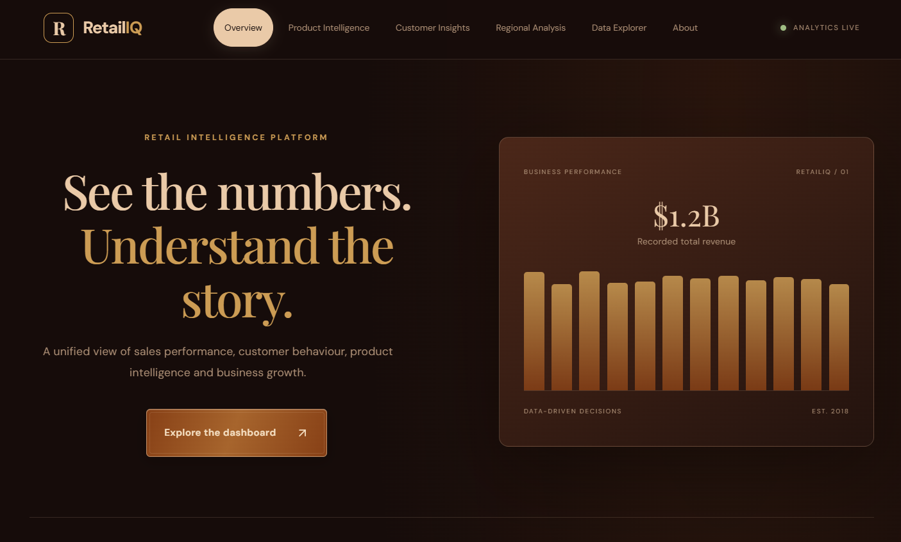
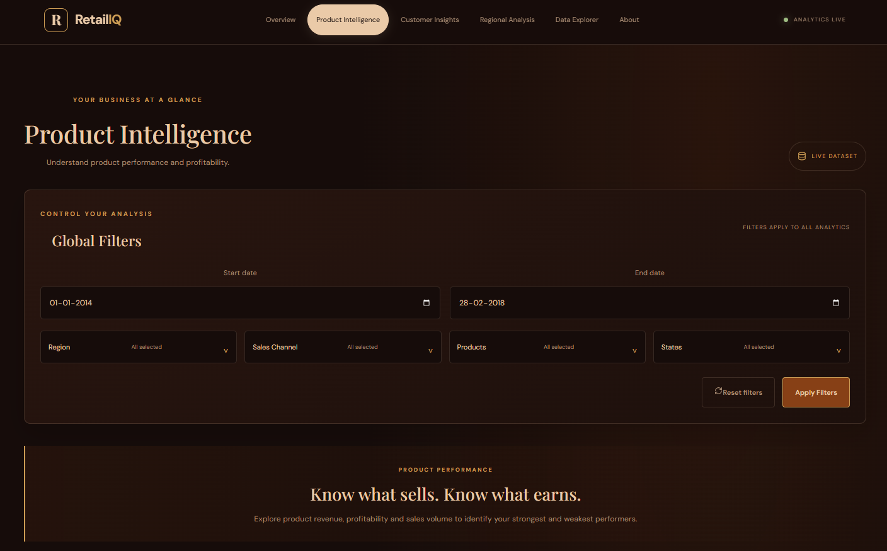
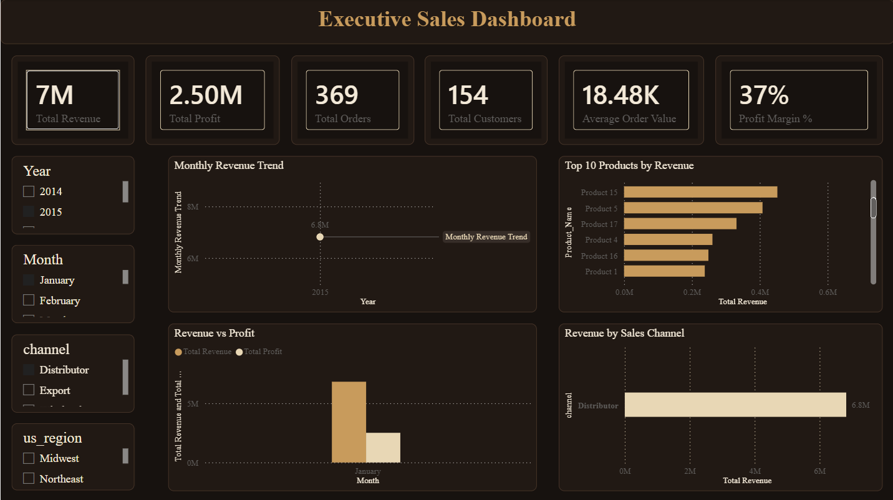
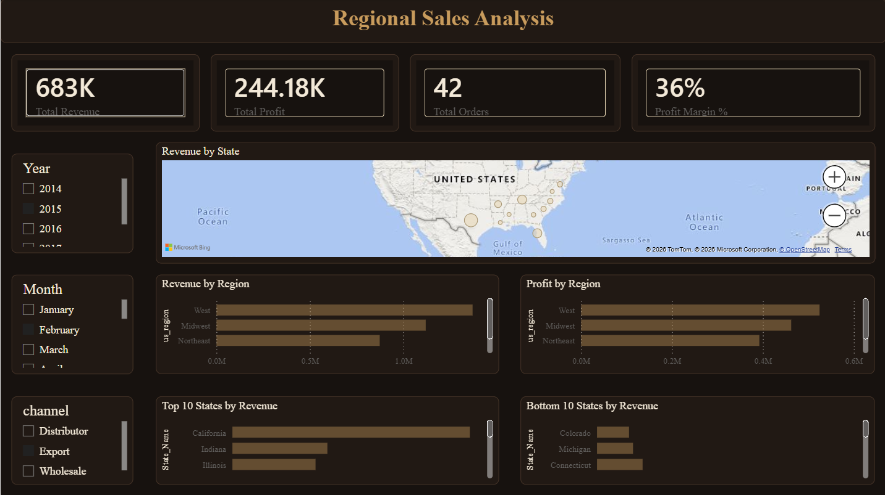
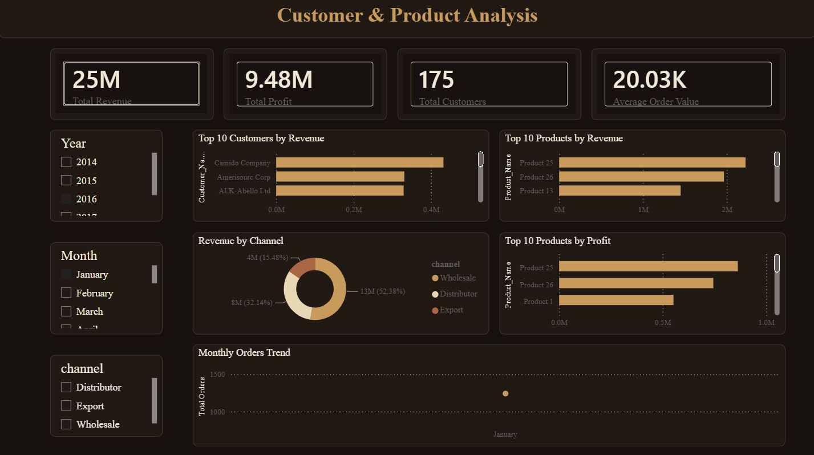

# 🛍️ RetailIQ
### Retail Business Intelligence & Analytics Platform

Transforming retail sales data into actionable business insights.

**Built with:** Python · SQL · Power BI · React · FastAPI

[🚀 Live Application](https://retail-iq-analytics-ten.vercel.app/) | [📊 Power BI Dashboard](powerbi/Retail_Sales_Dashboard.pbix) | [💻 GitHub Repository](https://github.com/Vivek-60206/RetailIQ-Analytics)

[](https://retail-iq-analytics-ten.vercel.app/)
[](https://retailiq-analytics-irlz.onrender.com/)
[](https://retailiq-analytics-irlz.onrender.com/docs)

---

## 📌 Project Overview

**RetailIQ** is an end-to-end retail business intelligence and analytics platform designed to transform raw retail sales data into meaningful business insights.

It combines **Python-based data analysis, SQL business queries, interactive Power BI dashboards, and a React-powered web application** to analyze sales performance, profitability, customer behaviour, and regional trends.

The platform demonstrates how data analytics, business intelligence, and modern web technologies can work together to support informed business decisions.

## 🎯 Project Objectives

- Analyze retail sales and profitability across different regions.
- Identify high-performing products and customer segments.
- Understand monthly and regional sales trends.
- Extract business insights using SQL queries.
- Develop interactive dashboards for business reporting.
- Present analytical findings through a web-based application.

## ✨ Key Features

| Feature | Description |
|---|---|
| 📊 Sales Overview | Monitor revenue, profit, orders, and overall sales performance. |
| 📦 Product Intelligence | Analyze product-wise sales and profitability. |
| 👥 Customer Insights | Explore customer contributions and purchasing patterns. |
| 🌎 Regional Analysis | Compare performance across US states and regions. |
| 🔎 Data Explorer | Explore and filter retail sales records. |
| 📈 Power BI Reports | Interactive dashboards for business intelligence. |
| ⚙️ REST API | FastAPI backend serving analytical data to the frontend. |

## 🧰 Technology Stack

| Category | Technologies |
|---|---|
| Programming | Python, JavaScript |
| Frontend | React, Vite, CSS |
| Backend | FastAPI, Uvicorn |
| Data Analysis | Pandas, NumPy, Jupyter Notebook |
| Database & Queries | SQL |
| Visualization | Power BI, Recharts, Matplotlib |
| Development Tools | VS Code, Git, GitHub |

---

## 🖥️ Web Application

RetailIQ provides an interactive web interface to explore retail business performance through multiple analytical sections.

### 📊 Sales Overview



### 📦 Product Intelligence



**Explore the live application:** [RetailIQ Dashboard](https://retail-iq-analytics-ten.vercel.app/)

---

## 📈 Power BI Dashboards

The Power BI report contains three analytical pages designed to examine retail performance from different business perspectives.

### 1. Executive Sales Dashboard



### 2. Regional Sales Analysis



### 3. Customer & Product Analysis



📥 **[View / Download Power BI Report](powerbi/Retail_Sales_Dashboard.pbix)**

---

## 📂 Dataset Overview

The project uses a retail sales dataset containing transactional, customer, product, and geographical information.

| Dataset Attribute | Details |
|---|---|
| Total Records | 64,104 |
| Total Columns | 21 |
| Date Range | January 2014 – February 2018 |
| Customers | 175 |
| Products | 30 |
| US States | 47 |
| Regions | 4 |
| Sales Channels | 3 |

### Key Dataset Fields

- `Order_Number` – Unique order identifier.
- `order_date` – Date of transaction.
- `Customer_Name` – Customer information.
- `Product_Name` – Product information.
- `quantity` – Units sold.
- `Unit_Price` – Price per unit.
- `revenue` – Sales revenue.
- `cost` – Unit cost.
- `profit` – Profit generated.
- `Profit_Margin_Pct` – Profit margin percentage.
- `state` – State information.
- `us_region` – Geographical region.
- `channel` – Sales channel.

## 🐍 Python Data Analysis

Python was used to explore, prepare, and analyze the retail dataset.

**Analysis activities include:**

- Data loading and exploration using Pandas.
- Identifying missing values and duplicate records.
- Data transformation and preparation.
- Revenue and profit calculations.
- Product and customer performance analysis.
- Regional and monthly sales analysis.
- Visualization of business trends.

## 🗄️ SQL Business Analysis

SQL queries were used to answer business-oriented questions and extract useful insights.

**Areas of analysis:**

- Total revenue and profit.
- Monthly sales performance.
- Top-performing products.
- Customer-wise sales contribution.
- Regional sales comparison.
- Profitability analysis.

## 📊 Key Business Metrics

The following metrics summarize the analyzed dataset:

| Business Metric | Value |
|---|---:|
| 💰 Total Revenue | $1.236 Billion |
| 📈 Total Profit | $461.77 Million |
| 📊 Profit Margin | 37.36% |
| 🧾 Total Orders | 10,684 |
| 📦 Units Sold | 541,146 |
| 👥 Total Customers | 175 |

---

## 🗂️ Project Structure

<details>
<summary><strong>📁 Click to View Complete Project Structure</strong></summary>

```text
RetailIQ-Analytics/
│
├── backend/                  # FastAPI backend
├── data/                     # Raw and processed datasets
├── frontend/                 # React + Vite application
├── notebooks/                # Python analysis notebooks
├── powerbi/                  # Power BI dashboard
├── screenshots/              # Project screenshots
├── sql/                      # SQL analysis queries
├── streamlit/                # Earlier Streamlit implementation
│
├── .gitignore
├── LICENSE
├── README.md
└── requirements.txt
```

</details>

---

## ⚙️ Installation & Local Setup

Follow these steps to run RetailIQ locally.

### 1. Clone the Repository

```bash
git clone https://github.com/Vivek-60206/RetailIQ-Analytics.git

cd RetailIQ-Analytics
```

### 2. Install Python Dependencies

```bash
python -m pip install -r requirements.txt
```

### 3. Start the Backend

```bash
python -m uvicorn backend.main:app# 🛍️ RetailIQ
### Retail Business Intelligence & Analytics Platform

Transforming retail sales data into actionable business insights.

**Built with:** Python · SQL · Power BI · React · FastAPI

[🚀 Live Application](https://retail-iq-analytics-ten.vercel.app/) | [📊 Power BI Dashboard](powerbi/Retail_Sales_Dashboard.pbix) | [💻 GitHub Repository](https://github.com/Vivek-60206/RetailIQ-Analytics)

[](https://retail-iq-analytics-ten.vercel.app/)
[](https://retailiq-analytics-irlz.onrender.com/)
[](https://retailiq-analytics-irlz.onrender.com/docs)

---

## 📌 Project Overview

**RetailIQ** is an end-to-end retail business intelligence and analytics platform designed to transform raw retail sales data into meaningful business insights.

It combines **Python-based data analysis, SQL business queries, interactive Power BI dashboards, and a React-powered web application** to analyze sales performance, profitability, customer behaviour, and regional trends.

The platform demonstrates how data analytics, business intelligence, and modern web technologies can work together to support informed business decisions.

## 🎯 Project Objectives

- Analyze retail sales and profitability across different regions.
- Identify high-performing products and customer segments.
- Understand monthly and regional sales trends.
- Extract business insights using SQL queries.
- Develop interactive dashboards for business reporting.
- Present analytical findings through a web-based application.

## ✨ Key Features

| Feature | Description |
|---|---|
| 📊 Sales Overview | Monitor revenue, profit, orders, and overall sales performance. |
| 📦 Product Intelligence | Analyze product-wise sales and profitability. |
| 👥 Customer Insights | Explore customer contributions and purchasing patterns. |
| 🌎 Regional Analysis | Compare performance across US states and regions. |
| 🔎 Data Explorer | Explore and filter retail sales records. |
| 📈 Power BI Reports | Interactive dashboards for business intelligence. |
| ⚙️ REST API | FastAPI backend serving analytical data to the frontend. |

## 🧰 Technology Stack

| Category | Technologies |
|---|---|
| Programming | Python, JavaScript |
| Frontend | React, Vite, CSS |
| Backend | FastAPI, Uvicorn |
| Data Analysis | Pandas, NumPy, Jupyter Notebook |
| Database & Queries | SQL |
| Visualization | Power BI, Recharts, Matplotlib |
| Development Tools | VS Code, Git, GitHub |

---

## 🖥️ Web Application

RetailIQ provides an interactive web interface to explore retail business performance through multiple analytical sections.

### 📊 Sales Overview


### 📦 Product Intelligence


**Explore the live application:** [RetailIQ Dashboard](https://retail-iq-analytics-ten.vercel.app/)

---

## 📈 Power BI Dashboards

The Power BI report contains three analytical pages designed to examine retail performance from different business perspectives.

### 1. Executive Sales Dashboard


### 2. Regional Sales Analysis


### 3. Customer & Product Analysis


📥 **[View / Download Power BI Report](powerbi/Retail_Sales_Dashboard.pbix)**

---

## 📂 Dataset Overview

The project uses a retail sales dataset containing transactional, customer, product, and geographical information.

| Dataset Attribute | Details |
|---|---|
| Total Records | 64,104 |
| Total Columns | 21 |
| Date Range | January 2014 – February 2018 |
| Customers | 175 |
| Products | 30 |
| US States | 47 |
| Regions | 4 |
| Sales Channels | 3 |

### Key Dataset Fields

- `Order_Number` – Unique order identifier.
- `order_date` – Date of transaction.
- `Customer_Name` – Customer information.
- `Product_Name` – Product information.
- `quantity` – Units sold.
- `Unit_Price` – Price per unit.
- `revenue` – Sales revenue.
- `cost` – Unit cost.
- `profit` – Profit generated.
- `Profit_Margin_Pct` – Profit margin percentage.
- `state` – State information.
- `us_region` – Geographical region.
- `channel` – Sales channel.

## 🐍 Python Data Analysis

Python was used to explore, prepare, and analyze the retail dataset.

**Analysis activities include:**

- Data loading and exploration using Pandas.
- Identifying missing values and duplicate records.
- Data transformation and preparation.
- Revenue and profit calculations.
- Product and customer performance analysis.
- Regional and monthly sales analysis.
- Visualization of business trends.

## 🗄️ SQL Business Analysis

SQL queries were used to answer business-oriented questions and extract useful insights.

**Areas of analysis:**

- Total revenue and profit.
- Monthly sales performance.
- Top-performing products.
- Customer-wise sales contribution.
- Regional sales comparison.
- Profitability analysis.

## 📊 Key Business Metrics

The following metrics summarize the analyzed dataset:

| Business Metric | Value |
|---|---:|
| 💰 Total Revenue | $1.236 Billion |
| 📈 Total Profit | $461.77 Million |
| 📊 Profit Margin | 37.36% |
| 🧾 Total Orders | 10,684 |
| 📦 Units Sold | 541,146 |
| 👥 Total Customers | 175 |

---

## 🗂️ Project Structure

<details>
<summary><strong>📁 Click to View Complete Project Structure</strong></summary>

```text
RetailIQ-Analytics/
│
├── backend/                  # FastAPI backend
├── data/                     # Raw and processed datasets
├── frontend/                 # React + Vite application
├── notebooks/                # Python analysis notebooks
├── powerbi/                  # Power BI dashboard
├── screenshots/              # Project screenshots
├── sql/                      # SQL analysis queries
├── streamlit/                # Earlier Streamlit implementation
│
├── .gitignore
├── LICENSE
├── README.md
└── requirements.txt
```

</details>

---

## ⚙️ Installation & Local Setup

Follow these steps to run RetailIQ locally.

### 1. Clone the Repository

```bash
git clone https://github.com/Vivek-60206/RetailIQ-Analytics.git

cd RetailIQ-Analytics
```

### 2. Install Python Dependencies

```bash
python -m pip install -r requirements.txt
```

### 3. Start the Backend

```bash
python -m uvicorn backend.main:app